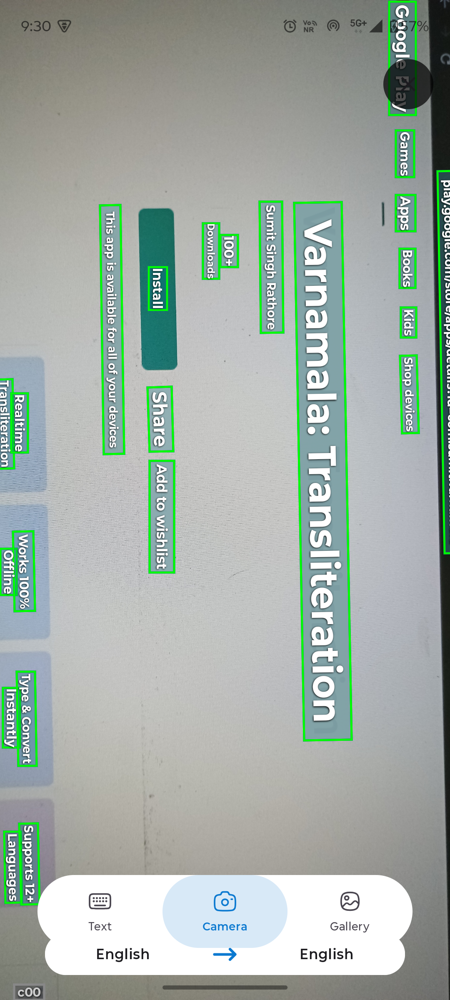
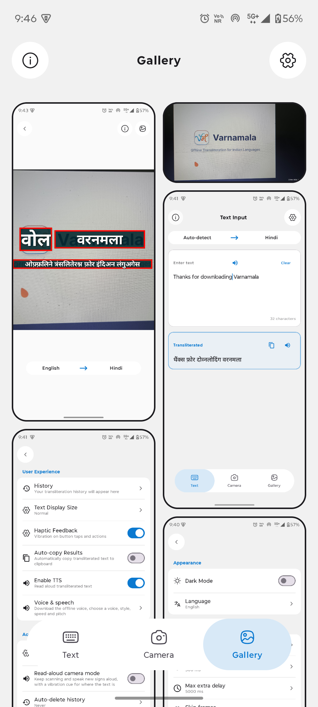
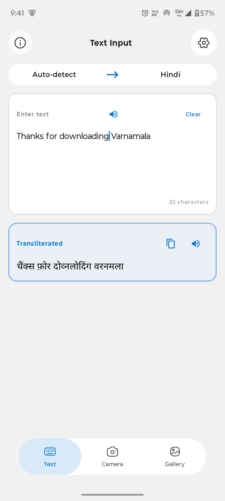
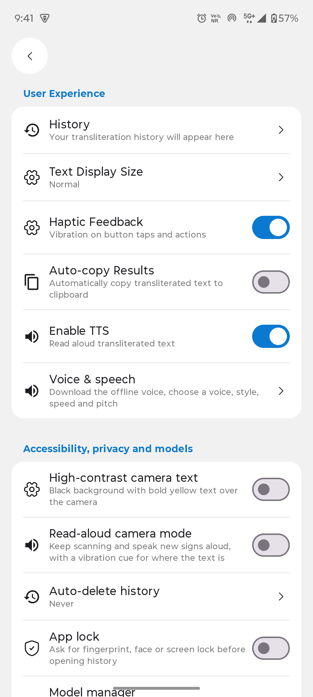

<div align="center">


# Varnamala (Version 1)

<p align="center">
  <strong>Transform Indian scripts into readable English and across Indic languages - 100% offline & private on-device AI.</strong>
</p>

[](https://developer.android.com)
[](https://kotlinlang.org)
[](https://developer.android.com/jetpack/compose)
[](https://github.com/PaddlePaddle/PaddleOCR)
[](https://onnxruntime.ai)
[](https://github.com/virtualvinodh/aksharamukha)
[](https://gradle.org)
[](https://developer.android.com/topic/architecture)
[](LICENSE)

<br/>


<br/><br/>

### Download

<p align="center">
  <a href="https://play.google.com/store/apps/details?id=com.sumit.varnamala" target="_blank" rel="noopener noreferrer">
    
  </a>
  <a href="https://www.indusappstore.com/app/com.sumit.varnamala" target="_blank" rel="noopener noreferrer">
    
  </a>
</p>

</div>

---

## 📑 Table of Contents

- [Features](#-features)
  - [Core Capabilities](#-core-capabilities)
- [Screenshots](#-screenshots)
- [Architecture & Modules](#️-architecture--modules)
- [Aksharamukha Transliteration Engine](#-aksharamukha-transliteration-engine)
  - [Supported Scripts & Schemes](#supported-scripts--schemes)
  - [JSON Mapping Resources](#json-mapping-resources)
  - [Code Example](#code-example)
- [Getting Started](#-getting-started)
  - [Prerequisites](#prerequisites)
  - [Build from Source](#build-from-source)
  - [Building Signed Release APKs](#building-signed-release-apks)
  - [Automated Release via GitHub Actions](#automated-release-via-github-actions)
- [AI Agents & Developer Tooling](#-ai-agents--developer-tooling)
- [Contributing](#-contributing)
- [License](#-license)

---

> [!NOTE]
> This repository contains the complete open-source codebase for **Varnamala Version 1**. Version 1 is fully functional, sanitized, and ready for community contributions and on-device research. Version 2 is actively under development in a separate repository.

---

## ✨ Features

### 🎯 Core Capabilities

- 📷 **Live Camera OCR**: Real-time scene text detection and recognition powered by PaddleOCR PP-OCRv6 ONNX models. Bounding boxes dynamically overlay with calculated font scaling and clean text clipping (no ellipses). Continuous camera preview without modal freezing.
- 🖼️ **Gallery & Image Detail Inspection**: Interactive zoom/pan viewer with 1:1 pixel-mapped OCR bounding boxes, tap-to-copy, and text-to-speech.
- 🔤 **Aksharamukha & KMP Transliteration**: Pure Kotlin Multiplatform engine with native Aksharamukha script conversion across 12+ Indic scripts and international Romanization schemes.
- ⌨️ **Text Transliteration**: Direct typing mode converting seamlessly across Indic scripts (Devanagari, Bengali, Tamil, Telugu, Kannada, Malayalam, Gujarati, Gurmukhi, Odia, Assamese, Urdu) and Roman scripts (IAST, ISO 15919, Harvard-Kyoto).
- 🔒 **Privacy & Biometric Guard**: 100% on-device processing. Scan history can be optionally secured via Biometrics (Fingerprint / Face Unlock) using `BiometricPrompt`.
- 🔊 **Offline Text-to-Speech**: Integrated Android TTS and neural Rasa TTS for pronunciation assistance.

---

## 📱 Screenshots

<div align="center">

| 📷 Live Camera OCR | 🖼️ Gallery & Zoom | ⌨️ Text Transliteration | ⚙️ Settings & Security |
| :---: | :---: | :---: | :---: |
|  |  |  |  |
| Point at text with live bounding box overlay | Pinch-to-zoom with 1:1 mapped OCR boxes | Type or paste text across Indic scripts | Custom font scale, themes, biometric lock |

</div>

---

## 🏛️ Architecture & Modules

The repository is modularized for clarity and reusability:

| Module | Documentation | Description |
| :--- | :--- | :--- |
| **`:app`** | [app/README.md](app/README.md) | Jetpack Compose Android UI, CameraX scanner, gallery viewer, DataStore settings, and biometric security. |
| **`:ppocr-sdk`** | [ppocr-sdk/README.md](ppocr-sdk/README.md) | On-device OCR engine using ONNX Runtime (Mobile), DBNet detection, Vatti polygon unclipping, and CTC recognizer. |
| **`:transliteration`** | [transliteration/README.md](transliteration/README.md) | Zero-dependency Kotlin Multiplatform (KMP) transliteration engine and integrated Aksharamukha script processor. |

---

## 🔤 Aksharamukha Transliteration Engine

Varnamala integrates the **Aksharamukha** transliteration paradigm directly into the `:transliteration` Kotlin Multiplatform module:

### Supported Scripts & Schemes
- **Indic Scripts**: Devanagari, Bengali, Assamese, Gurmukhi, Gujarati, Oriya, Tamil, Telugu, Kannada, Malayalam, Sinhala, Urdu.
- **Romanization Schemes**: IAST, ISO 15919, Harvard-Kyoto (HK), ITRANS, Velthuis, SLP1, WX.

### JSON Mapping Resources
All character matrices and mapping datasets are stored as standalone JSON files under [`transliteration/src/commonMain/resources/aksharamukha/`](transliteration/src/commonMain/resources/aksharamukha/):
- [`Devanagari.json`](transliteration/src/commonMain/resources/aksharamukha/Devanagari.json)
- [`Bengali.json`](transliteration/src/commonMain/resources/aksharamukha/Bengali.json)
- [`Assamese.json`](transliteration/src/commonMain/resources/aksharamukha/Assamese.json)
- [`Tamil.json`](transliteration/src/commonMain/resources/aksharamukha/Tamil.json)
- [`Telugu.json`](transliteration/src/commonMain/resources/aksharamukha/Telugu.json)
- [`Kannada.json`](transliteration/src/commonMain/resources/aksharamukha/Kannada.json)
- [`Malayalam.json`](transliteration/src/commonMain/resources/aksharamukha/Malayalam.json)
- [`Gujarati.json`](transliteration/src/commonMain/resources/aksharamukha/Gujarati.json)
- [`Gurmukhi.json`](transliteration/src/commonMain/resources/aksharamukha/Gurmukhi.json)
- [`Oriya.json`](transliteration/src/commonMain/resources/aksharamukha/Oriya.json)
- [`IAST.json`](transliteration/src/commonMain/resources/aksharamukha/IAST.json)
- [`ISO15919.json`](transliteration/src/commonMain/resources/aksharamukha/ISO15919.json)
- [`HK.json`](transliteration/src/commonMain/resources/aksharamukha/HK.json)
- [`ITRANS.json`](transliteration/src/commonMain/resources/aksharamukha/ITRANS.json)
- [`scripts.json`](transliteration/src/commonMain/resources/aksharamukha/scripts.json) (Catalog Index)

### Code Example
```kotlin
import com.sumit.varnamala.transliteration.Aksharamukha

// Direct script-to-script
val telugu = Aksharamukha.process("Devanagari", "Telugu", "नमस्ते")
// -> "నమస్తే"

// Roman HK to Devanagari
val devanagari = Aksharamukha.process("HK", "Devanagari", "kRSNa")
// -> "कृष्ण"

// Dynamic script matrix inspection
val devaMap = Aksharamukha.getScriptMapping("Devanagari")
```

---

## 🚀 Getting Started

### Prerequisites

- **JDK 17+**
- **Android SDK Platform 37**
- **Gradle 9.8.2** (included via Gradle Wrapper `./gradlew`)

### Build from Source

```bash
# Clone the repository
git clone https://github.com/developer-sumit/varnamala-transliteration.git
cd varnamala

# Build debug APK (out-of-the-box, no secrets needed)
./gradlew assembleDebug

# Run unit tests
./gradlew :transliteration:jvmTest
```

### Building Signed Release APKs

This open-source repository contains **no proprietary keystores or passwords**:
1. Copy `key.properties.template` to `key.properties`:
   ```bash
   cp key.properties.template key.properties
   ```
2. Fill in your release keystore path and passwords.
3. Run `./gradlew assembleRelease`. When `key.properties` is absent, release builds safely fall back without breaking.

### Automated Release via GitHub Actions

The repository includes a GitHub Actions workflow [`.github/workflows/build-release.yml`](.github/workflows/build-release.yml) that builds signed release APKs across all supported ABIs (`arm64-v8a`, `armeabi-v7a`, `x86`, `x86_64`, `universal`) and publishes them directly to a GitHub Release.

You can trigger this release build in two ways:

#### Option 1: Push a Version Tag (Recommended)

Tag your commit with a version starting with `v` (e.g., `v1.0.0` or `v1.0.0-beta`) and push the tag to GitHub:

```bash
# Tag the current commit
git tag v1.0.0

# Push the tag to trigger the workflow
git push origin v1.0.0
```

#### Option 2: Trigger Manually in GitHub Actions

1. Go to your repository on GitHub.
2. Select the **Actions** tab.
3. In the left workflow list, click **Build Release APK**.
4. Click **Run workflow**, specify the target branch and version tag (e.g., `v1.0.0`), then click **Run workflow**.

> [!NOTE]
> The automated release workflow requires repository secrets configured under **Settings > Secrets and variables > Actions**:
> - `KEYSTORE_BASE64`: Base64 string of your `.jks` keystore file (`base64 -w 0 your-keystore.jks`)
> - `KEYSTORE_PASSWORD`: Keystore password
> - `KEY_ALIAS`: Keystore alias name
> - `KEY_PASSWORD`: Key password
>
> The triggering GitHub user must also be authorized in `ALLOWED_ACTORS` inside `.github/workflows/build-release.yml`.

---

## 🤖 AI Agents & Developer Tooling

This repository is designed for both human developers and autonomous AI coding agents:

- **AI Agent Skill**: [`.agents/skills/varnamala-development/SKILL.md`](.agents/skills/varnamala-development/SKILL.md) & [`skills/varnamala-development/SKILL.md`](skills/varnamala-development/SKILL.md) contain the definitive guidelines, architecture rules, and testing standards.

---

## 🤝 Contributing

Contributions are welcome! Please ensure:
1. No confidential credentials or keystores are committed.
2. Code follows Kotlin and Jetpack Compose best practices.
3. Tests pass: `./gradlew :transliteration:jvmTest`.
4. Run `bash scripts/check_secrets.sh` prior to submitting pull requests.

---

## 📜 License

This project is licensed under the **MIT License** - see the [LICENSE](LICENSE) file for details.
